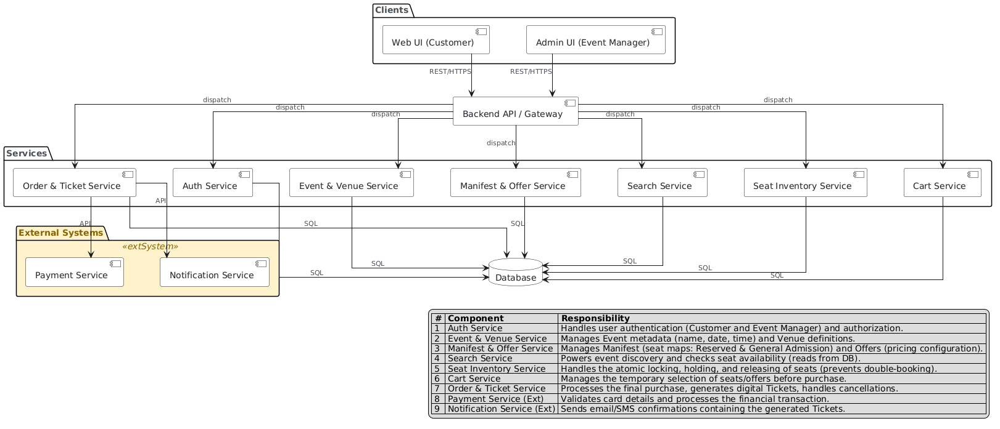
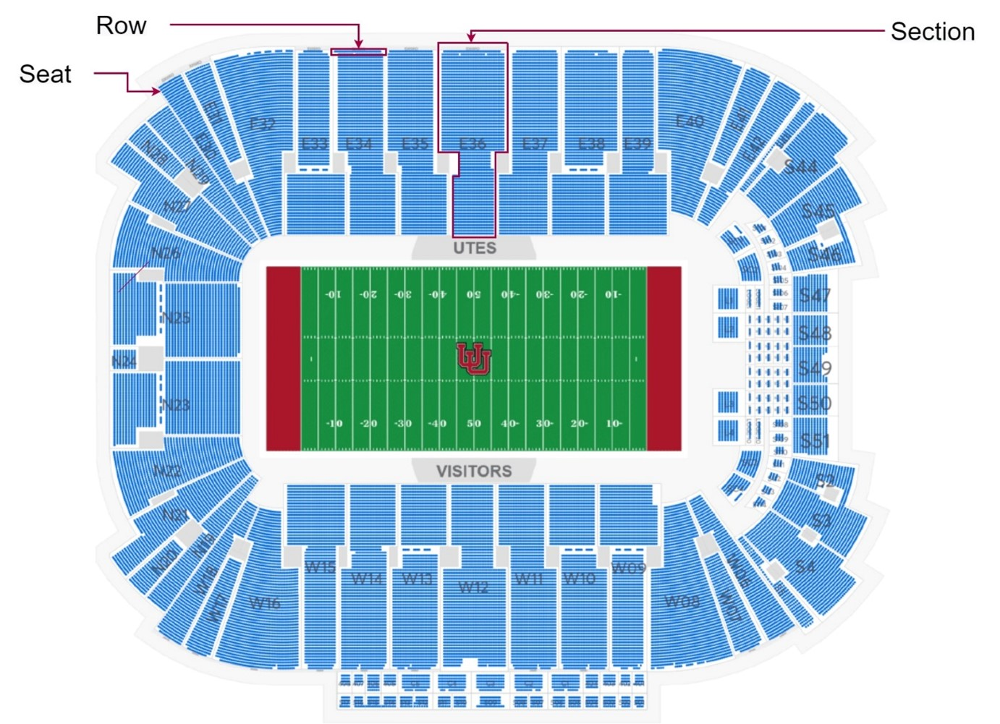
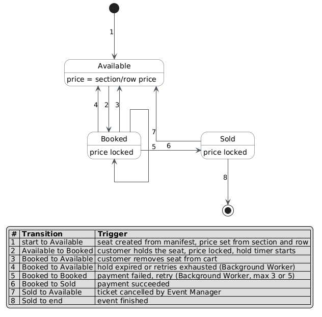
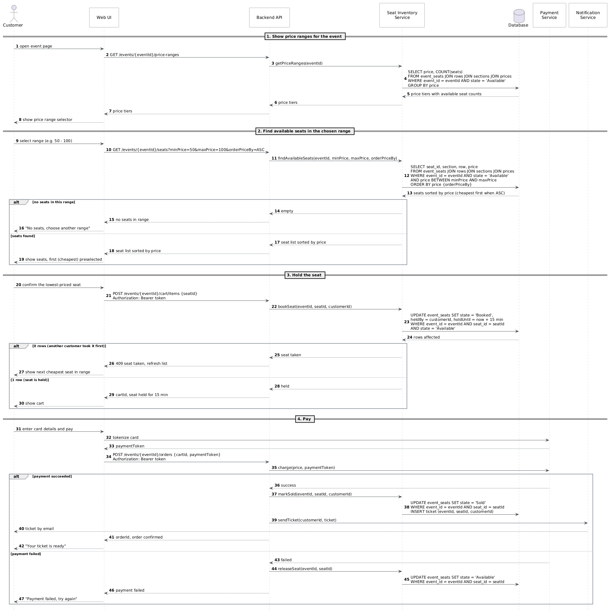

# EPM-TKT — Event Ticketing System

An online event ticketing platform built with .NET 10 / ASP.NET Core. Customers browse events, select and hold seats, pay, and receive digital tickets. Event Managers configure venues, seat manifests, and pricing offers.

## Solution Structure

```
EPM.TKT.slnx
├── EPM.TKT.WebApi/         # HTTP API entry point, controllers, OpenAPI
├── EPM.TKT.App/            # Application layer — commands, queries, handlers
├── EPM.TKT.Domain/         # Domain entities, value objects, business rules
├── EPM.TKT.Infrastructure/ # EF Core, repositories, DB migrations
├── EPM.TKT.External/       # External service clients (Payment, Notification)
├── EPM.TKT.Mediator/       # MediatR pipeline behaviours
└── EPM.TKT.Tests/          # Unit and integration tests
```

## Architecture Overview

The Backend API / Gateway dispatches requests to internal services. Payment and Notification are external systems.



## Domain Concepts

| Term | Description |
|---|---|
| **Event** | Container for venue, date/time, and event metadata |
| **Venue** | Physical location where an event takes place |
| **Manifest** | Complete seat map for a venue (`Section → Row → Seat`) |
| **Seat** | Smallest purchasable unit — *Reserved* (specific seat) or *General Admission* |
| **Offer** | Selling configuration applied to seats (price levels, rules) |
| **Price** | Ticket price level (Adult, Child, VIP, etc.) set at section or row level |
| **Ticket** | Digital/printed proof of purchase with event, venue, seat, and date info |
| **Customer** | Authenticated user who searches and purchases tickets |
| **Event Manager** | Admin user who sets up venues, manifests, and offers |

### Venue Seat Map

A Manifest maps out a venue into Sections, each containing Rows and individual Seats.



## Seat Lifecycle

A held seat is locked to the customer for **15 minutes**. Expired holds and failed payment retries (max 3–5) are released by a background worker.



## Customer Purchase Flow



## Key API Endpoints

| Method | Endpoint | Description |
|---|---|---|
| `GET` | `/events/{eventId}/price-ranges` | Available price tiers with seat counts |
| `GET` | `/events/{eventId}/seats` | Seats filtered by `minPrice`, `maxPrice`, `orderBy` |
| `POST` | `/events/{eventId}/cart/items` | Hold a seat (requires Bearer token) |
| `POST` | `/events/{eventId}/orders` | Complete purchase (requires Bearer token) |

## Getting Started

### Prerequisites

- [.NET 10 SDK](https://dotnet.microsoft.com/download)

### Build

```bash
dotnet build EPM.TKT.slnx
```

### Run

```bash
dotnet run --project EPM.TKT.WebApi
```

OpenAPI schema available at `/openapi/v1.json` in development.

### Test

```bash
dotnet test EPM.TKT.slnx
```
